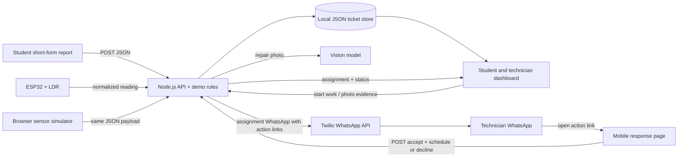

# Three-Engineer Build Workflow

## Target demo

Show a student issue or LDR sensor alert becoming a ticket without the student navigating a long helpdesk form or department hierarchy. The assigned technician receives a WhatsApp message and accepts/schedules or declines through its links; a decline moves the ticket to the next available technician and sends another message. Students receive a private tracking page. Completion needs a technician photo approved by AI, and lighting tickets also need recovered sensor readings.

The standalone demo runs locally with Node.js and a browser. The LDR simulator is the guaranteed path; use the physical sensor only if it is stable.

## Architecture

## Stack

- **UI:** HTML, CSS, and browser JavaScript for this time-boxed prototype; no frontend build step.
- **API:** Node.js built-in HTTP server; no extra runtime packages.
- **WhatsApp:** Twilio sends response links on assignment and reassignment to `FIXFLOW_WHATSAPP_TO`.
- **Technician response:** the technician opens a mobile response page from WhatsApp, chooses a schedule and accepts or confirms decline. The dashboard does not offer accept/decline controls.
- **Completion proof:** the technician uploads a photo. The configured vision model must pass it before the server closes the ticket.
- **Phone URL:** set `FIXFLOW_PUBLIC_URL` to a public HTTPS URL reachable from any network. Use a tunnel for the live demo or deploy the app to a public host.
- **Persistence:** local `demo/data/tickets.json` file.
- **Sensor:** browser simulator first; ESP32 can POST the same event JSON to `/api/sensor-events`.

## Ownership

### Engineer 1 — API and ticket workflow

- Own `demo/server.mjs` and API contract changes.
- Implement request validation, deterministic issue classification, available-technician routing, decline reassignment, schedule actions, duplicate prevention, and sensor verification.
- Send assignment/reassignment WhatsApp messages through Twilio with one-time response links; process the phone form action and rotate/invalidate links as assignment state changes.
- Require a completion photo and a passing AI verdict for ticket completion.
- Configure the app's public URL for links opened on another device.
- Keep all status transitions and assignments on the server.
- Pair with Engineer 3 to connect the sensor to `/api/sensor-events` if the hardware is ready.

### Engineer 2 — student and technician interface

- Own `demo/public/index.html` and its dashboard interactions.
- Keep the student form short: issue description and location only.
- Keep the dashboard focused on ticket state and repair progress. Accept/decline belongs only to the mobile WhatsApp response page.
- Display tickets, category, assignment, status, WhatsApp delivery state, photo evidence, sensor evidence, and activity timeline. Give student reporters a private tracking page.
- Poll the API for new assignments; do not locally invent statuses.

### Engineer 3 — sensor and demo integration

- Calibrate the LDR and normalize values to `brightness_pct` from 0 to 100.
- Send the payload in `contracts/examples/sensor-event.request.json` if integrating ESP32.
- Keep the browser simulator as the fallback; it already uses the same API shape.
- Own the reset/rehearsal sequence and the physical setup.

## 24-hour sequence

| Time | Shared milestone | Engineer 1 | Engineer 2 | Engineer 3 |
|---|---|---|---|---|
| 0–1 h | Agree on one ticket shape and demo story. Start the app locally. | Confirm API routes and status transitions. | Review the existing dashboard and visual flow. | Wire the LDR; note bright and dark readings. |
| 1–4 h | First visible end-to-end flow. | Finish report intake, rules, routing, and persistence. | Polish the form, ticket cards, and timeline. | Make low/recovery simulator values match the sensor contract. |
| 4–8 h | Sensor ticket appears once and is routed. | Finish sample thresholds and duplicate handling. | Show sensor state and assigned ticket in the UI. | Connect real LDR if reliable; otherwise rehearse simulator. |
| 8–12 h | Technician accepts and schedules from WhatsApp; decline reroutes to the next available person. | Enforce assignment availability, WhatsApp response actions, and server-side verification. | Finish the mobile response page and student tracker. | Calibrate thresholds and reset/demo setup. |
| 12–16 h | Full failure-then-recovery walkthrough. | Fix only API issues blocking the story. | Refine timeline and technician interaction. | Rehearse dim → failed repair → bright sequence. |
| 16–20 h | Feature freeze. | Prepare clean data and ensure reset works. | Polish layout, labels, and projector readability. | Confirm hardware fallback and runbook. |
| 20–24 h | Rehearse the pitch and demo repeatedly. | Narrate routing and ticket state. | Drive student and technician screens. | Trigger sensor or simulator and explain evidence. |

## Integration checkpoints

1. **Hour 1:** app starts at `http://localhost:3000` on each engineer’s machine.
2. **Hour 4:** a student report creates a ticket with the expected category and fictional assignment.
3. **Hour 8:** three low LDR readings create one lighting ticket; more low readings do not duplicate it.
4. **Hour 12:** technician accepts and schedules; a decline reassigns. A still-low reading after repair leaves the ticket in follow-up.
5. **Hour 16:** three bright readings after the repair attempt close the ticket and add a timeline event.
6. **Hour 20:** freeze features and rehearse the exact same scenario with a clean reset.

## Live demo script

1. Click **Simulate dim room** or cover the LDR; show three low readings create and route a lighting ticket.
2. Open the assignment WhatsApp on the technician phone. Accept and schedule the fix; optionally rehearse Decline to demonstrate reassignment and a fresh message to the next technician.
3. Start work and click **Mark repair attempted** while brightness remains low; show follow-up instead of a false close.
4. Click **Room is fixed** or brighten the LDR; show three recovery readings and automatic closure.
5. Submit “I cannot log in to the student portal” and open the private student page to show status and completion evidence.

If hardware fails, use the simulator. For the WhatsApp phone flow, keep the app and public tunnel running. Reset before each rehearsal.
