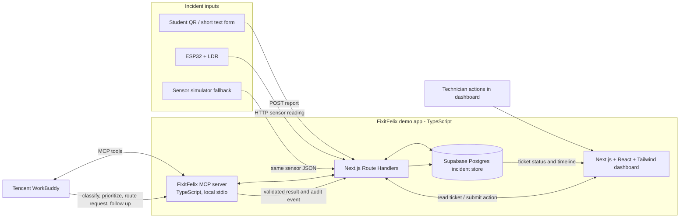

# Three-Engineer Build Workflow

## Goal for the 24-hour demo

Show Tencent WorkBuddy taking real workflow actions through a FixitFelix MCP server. A dim-room LDR reading or a student's short free-text report becomes a pending incident. WorkBuddy triages it, the system routes it to the demo technician, and a repair is followed up until the available evidence supports closure.

For the live demo, a person can prompt WorkBuddy to process pending incidents. The LDR event itself is recorded automatically, but do not claim that a sensor webhook automatically starts a WorkBuddy run unless that trigger has been implemented and confirmed in your WorkBuddy setup.

## Architecture / technology flow



Use the existing demo contract for JSON fields and thresholds. Keep the MCP server as a separate process so WorkBuddy can connect to it; its tools should call the app API rather than write around the agreed validation rules. For a local hackathon setup, WorkBuddy's connector guidance allows local MCP processes over stdio. If the team instead uses a remote MCP server, it needs an HTTPS endpoint and a supported transport. [WorkBuddy Connector guide](https://open.workbuddy.cn/en/docs/connector)

## Team ownership

### Engineer 1 — WorkBuddy agent and backend

- First prove WorkBuddy can call one local FixitFelix MCP tool. This is the highest-risk dependency, so do it before building the full app.
- Implement the pending incident store and API routes for student reports, sensor events, and ticket actions.
- Implement a fixed demo routing directory and state-transition/verification checks.
- Implement MCP tools with stable names and typed inputs/outputs:
  - `list_pending_incidents`
  - `get_incident_context`
  - `create_work_order`
  - `get_sensor_readings`
  - `verify_and_update_ticket`
- Write the WorkBuddy instruction/Skill text explaining which tool to call and in what order.
- The server validates every proposed category, priority, assignment, and state change. WorkBuddy must not directly close a ticket without passing the verification rule.

The work-order tool input should match this shape (the MCP server assigns the technician from its fixed directory):

```json
{
  "incident_id": "incident_001",
  "category": "lighting",
  "priority": "medium",
  "summary": "Room B-204 has insufficient light.",
  "rationale": "The LDR recorded three consecutive readings below the configured threshold."
}
```

### Engineer 2 — student and technician interface

- Build a minimal student form with only a free-text description and location; do not recreate the long helpdesk form.
- Build a ticket queue and detail view showing WorkBuddy's category, assignment, reason, current status, and event timeline.
- Add technician actions for accept, start work, and repair attempted.
- Add a clear “pending WorkBuddy triage” state so the audience can see what the agent still needs to do.
- Keep the sensor panel as a mountable component; Engineer 3 supplies it.

### Engineer 3 — LDR, simulator, and demo integration

- Calibrate the real LDR and normalize its readings to the agreed `brightness_pct` range.
- Send readings to the sensor endpoint using the example JSON in `contracts/examples/sensor-event.request.json`.
- Build a dashboard sensor panel and a simulator that submits the exact same payload. The simulator is the live fallback if hardware or Wi-Fi fails.
- Coordinate with Engineer 2 on the panel interface, but avoid editing the ticket queue/detail component.
- Own the seed/reset action and the physical demo setup: dim reading, failed repair, brighter reading.

## 24-hour sequence

| Time | Shared milestone | Engineer 1 | Engineer 2 | Engineer 3 |
|---|---|---|---|---|
| 0–1 h | Agree on the contract and demo story. Confirm everyone can open the same WorkBuddy account/client. | Start the MCP server and make WorkBuddy call a simple `list_pending_incidents` stub. | Sketch the queue/detail UI against the existing ticket JSON. | Check LDR wiring and capture raw readings in bright and dim conditions. |
| 1–4 h | Freeze field names, statuses, and tool inputs. | Implement incident storage, routing map, and MCP tool skeleton. | Build student intake, ticket queue, and detail/timeline using fixture data. | Calibrate and normalize LDR; build the sensor simulator payload. |
| 4–8 h | First integration: student report and sensor event both appear as pending incidents. | Connect MCP tools to the app API and make WorkBuddy create one routed ticket. | Connect the UI to the app API and show pending/assigned states. | Send real or simulated LDR events to the endpoint; deliver a sensor panel component. |
| 8–12 h | Run the whole happy path with WorkBuddy making the triage call. | Add duplicate prevention, technician actions, verification, and follow-up tool behavior. | Add technician actions and show WorkBuddy's rationale and timeline. | Integrate the panel and tune thresholds/debounce with the actual room setup. |
| 12–16 h | Demonstrate a repair attempt that fails verification, then recovers. | Ensure a low reading causes follow-up and a later valid reading allows closure. | Make failed verification and follow-up obvious in the ticket detail. | Rehearse the physical sequence and verify the simulator fallback/reset. |
| 16–20 h | Freeze new features; fix only demo-blocking issues. | Check MCP connection/recovery and prepare a clean seeded state. | Polish labels, visual hierarchy, and demo screens. | Prepare sensor setup, reset process, and a short live runbook. |
| 20–24 h | Rehearse the pitch and final demo; use the same sequence every time. | Drive WorkBuddy and explain its tool actions. | Drive student/technician screens. | Trigger the LDR/simulator and narrate the physical evidence. |

## Integration checkpoints

1. **Hour 1:** WorkBuddy can call a local MCP tool. If not, stop feature work and resolve connector setup as a team.
2. **Hour 4:** Frontend and backend agree on one ticket JSON and one sensor-event JSON. Keep the current examples as fixtures.
3. **Hour 8:** A student report and an LDR event each appear in the same pending incident list.
4. **Hour 12:** WorkBuddy creates a routed work order from a pending incident and the dashboard shows it.
5. **Hour 16:** Failed repair remains open; successful sensor verification closes it.
6. **Hour 20:** Feature freeze. The team rehearses the full sequence and the fallback.

## Live demo script

1. Student submits “The light in Room B-204 is too dim” or the LDR reports a sustained low reading.
2. Show the new incident in the dashboard as pending triage.
3. In WorkBuddy, ask it to process the pending incident. Show WorkBuddy call the MCP tools, classify the issue as lighting, and create a work order routed to Facilities - Electrical.
4. On the technician view, mark the repair attempted while the LDR still reads low. Ask WorkBuddy to check the case; it records failed verification and follow-up rather than closing it.
5. Raise the LDR reading (or use the simulator). Ask WorkBuddy to recheck. It records verified closure and the dashboard displays the final timeline.

If the sensor fails, use the simulator with the same API payload. If WorkBuddy disconnects, reconnect the MCP tool server and reset the demo; do not silently substitute hard-coded agent text for live WorkBuddy calls.
